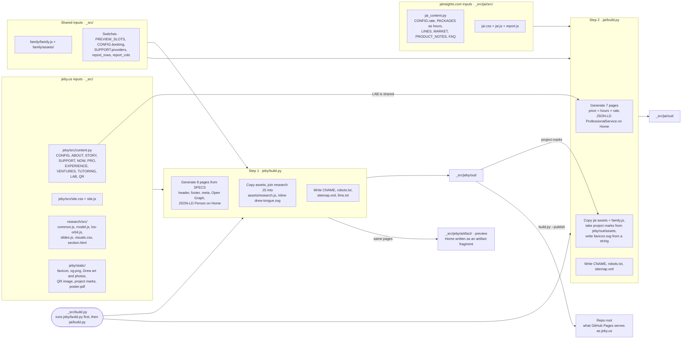
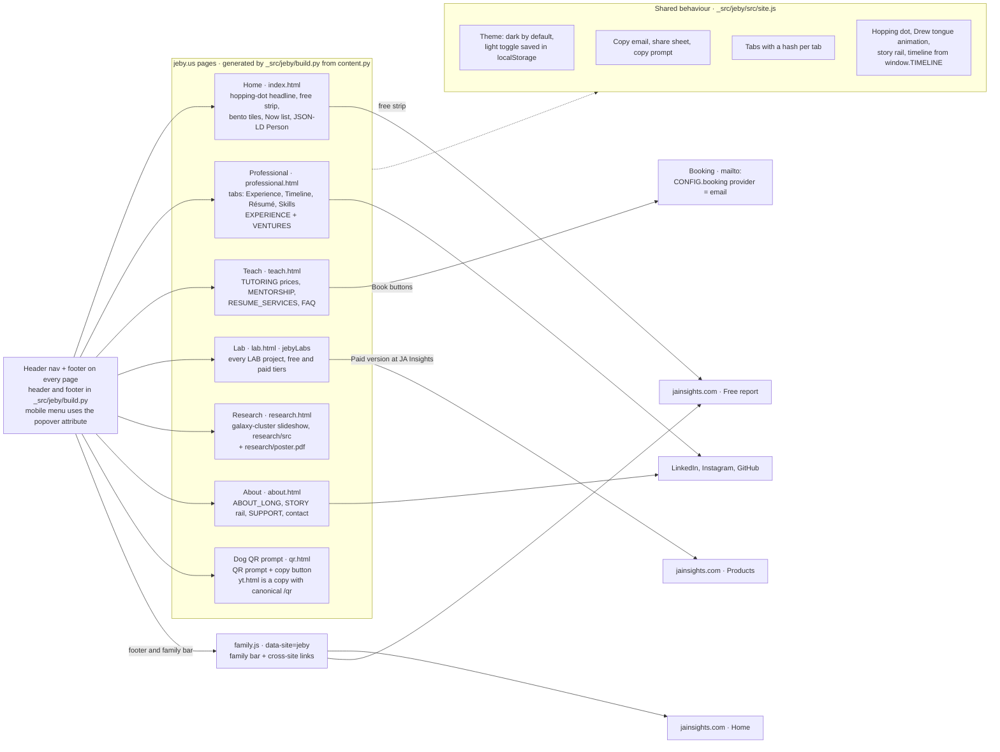
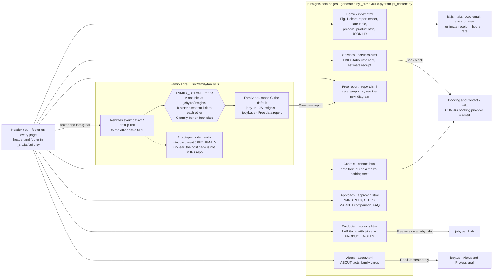
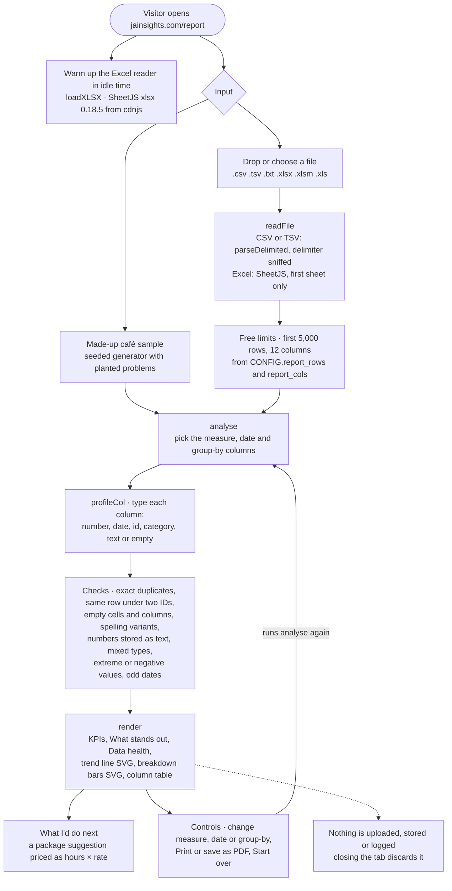

# jeby-us architecture

A snapshot of what exists in `jameseby21/jeby-us` on branch `redesign/2026-11-family-sites` (commit `6a9d762`), read on 2026-11-08. Every Mermaid block below also sits in `architecture/`, next to this file, as a `.mmd` source with an `.svg` render: [infrastructure](architecture/infrastructure.svg), [functionality-build](architecture/functionality-build.svg), [functionality-jeby-pages](architecture/functionality-jeby-pages.svg), [functionality-jai-pages](architecture/functionality-jai-pages.svg), [functionality-report](architecture/functionality-report.svg).

## 1. What this repo does today

This repo holds two static websites and the Python scripts that build them. The repo root is the built jeby.us, James Eby's personal site (Home, Professional, Teach, Lab, Research, About and a dog-QR prompt page), served by GitHub Pages under the domain in `CNAME`. The `_src/` folder holds the source for jeby.us and for jainsights.com, the JA Insights data-consulting site. Every word and price lives in two Python content files, and `python3 _src/build.py` writes plain HTML, CSS and JavaScript using only the Python standard library. `--publish` copies the jeby.us build into the repo root, and committing the root is what puts it live. jainsights.com is built here but served from a separate repository that is not part of this one. Both sites share one project list (the Lab, free editions on jeby.us and paid editions on jainsights.com) and a "jeby family" link bar (`family.js`). jainsights.com has a free one-page data report that reads a visitor's spreadsheet inside the browser and uploads nothing. On this branch the redesign is committed and the root matches the build output; `main` still holds the earlier one-page site. There are no tests and no CI. Planned, not live: online booking (Cal.com, Calendly or a form; today every booking button opens an email), sponsor buttons, a YouTube link and a résumé PDF (each hidden until its URL is filled in), email aliases, a jeby Real Estate site, and most paid products, which jainsights.com marks "Planned" or "In development". Prices, the hourly rate and the policy answers on jainsights.com, and the jeby.us story and QR prompt wording, are marked DRAFT in the source for the owner's review.

## 2. Infrastructure

```mermaid
flowchart LR
  subgraph local["Owner's machine"]
    src["Source · _src/<br/>content .py files, CSS, JS, static/, family/, research/"]
    build["Build · python3 _src/build.py<br/>Python 3.10+, standard library only"]
    jebyOut["_src/jeby/out/ · jeby.us build<br/>gitignored"]
    artifact["_src/jeby/artifact/ · preview build<br/>gitignored"]
    jaiOut["_src/jai/out/ · jainsights.com build<br/>gitignored"]
    rootFiles["Repo root · the published jeby.us<br/>*.html, assets/, CNAME, sitemap.xml, robots.txt, llms.txt"]
    gitLocal["git commit + push"]
  end

  subgraph github["GitHub"]
    repo["Repo jameseby21/jeby-us<br/>main = earlier one-page site<br/>redesign/2026-11-family-sites = this build"]
    pages["GitHub Pages · Jekyll branch build<br/>serves the repo root, skips _src/<br/>unclear: source branch is set in repo settings"]
    jaiRepo["Separate repo for jainsights.com<br/>unclear: name and copy step"]
    jaiPages["GitHub Pages for that repo<br/>CNAME jainsights.com"]
  end

  dnsE["DNS for jeby.us<br/>unclear: provider not named"]
  dnsJ["DNS for jainsights.com · Squarespace"]

  subgraph browser["Visitor's browser"]
    jebySite["jeby.us · static pages<br/>site.js, family.js, research.js"]
    jaiSite["jainsights.com · static pages<br/>jai.js, family.js, report.js"]
    fileIn["Visitor's CSV or Excel file<br/>read in the page, never uploaded"]
  end

  subgraph ext["External services"]
    fonts["Google Fonts · fonts.googleapis.com"]
    sheetjs["cdnjs · SheetJS xlsx 0.18.5"]
    mail["Visitor's email app · mailto: links"]
    social["LinkedIn, Instagram, GitHub · outbound links"]
  end

  noci["CI, tests, lockfiles · none in repo"]

  src --> build
  build -->|"jeby/build.py"| jebyOut
  build -->|"jeby/build.py"| artifact
  build -->|"jai/build.py"| jaiOut
  jebyOut -->|"build.py --publish copies"| rootFiles
  rootFiles --> gitLocal
  src --> gitLocal
  gitLocal -->|"push"| repo
  repo --> pages
  jaiOut -.->|"copied over, unclear how"| jaiRepo
  jaiRepo --> jaiPages
  pages -->|"HTTPS"| jebySite
  jaiPages -->|"HTTPS"| jaiSite
  dnsE -.-> pages
  dnsJ -.-> jaiPages
  jebySite -->|"web fonts"| fonts
  jaiSite -->|"web fonts"| fonts
  jaiSite -->|"lazy-loads for .xlsx"| sheetjs
  fileIn -->|"FileReader"| jaiSite
  jebySite <-->|"family links"| jaiSite
  jebySite --> mail
  jaiSite --> mail
  jebySite --> social
```

Notes:

- GitHub Pages serves the repository root. There is no `.nojekyll` and no `_config.yml`, so Pages runs its default Jekyll build, which skips folders whose names start with an underscore. That is why `_src/` is never published.
- On this branch the root matches `_src/jeby/out/` file for file (byte comparison on 2026-11-08; only the `CNAME` trailing newline differs).
- `_src/jeby/out/`, `_src/jai/out/` and `_src/jeby/artifact/` are build outputs and are gitignored (`_src/.gitignore`).
- `_src/README.md` gives the go-live order: jainsights.com first, then jeby.us, so the family links never point at an empty site.

Unclear or not in this repo:

- unclear: which branch GitHub Pages publishes. It is set in the repo's settings, not in files. `main` holds the earlier site, so if Pages serves `main` the redesign goes live only after a merge.
- unclear: the name of the jainsights.com repository and how `_src/jai/out/` gets copied into it. `_src/README.md` only says it has its own Pages site and `CNAME`, with DNS at Squarespace.
- unclear: the DNS provider for jeby.us.
- unclear: where the `_src/jeby/artifact/` preview is viewed. It is a second copy of the jeby.us pages with the Home page written as an artifact fragment.

## 3. Functionality

### 3a. Build pipeline

Switches in the content files: `PREVIEW_SLOTS` shows empty draft slots and unconfigured sponsor buttons and must stay `False` for anything published; `CONFIG["booking"]` picks email, Cal.com, Calendly or a form; `SUPPORT["providers"]` shows a sponsor button once its URL is set; `CONFIG["report_rows"]` and `CONFIG["report_cols"]` set the free report's limits. Prices on jainsights.com are never typed: each package stores hours and the build multiplies by the one rate.

### 3b. jeby.us pages

### 3c. jainsights.com pages and the family links

`family.js` runs on every page of both sites, told which site it is on by `data-site`. It rewrites each link marked `data-x` (site) and `data-p` (page) to the right address, and in mode C, the default, draws the shared family bar across the top of both sites.

### 3d. The in-browser free report

All of this runs in `_src/jai/src/report.js` on the visitor's device. The only network fetch is the SheetJS script, and only so `.xlsx` files can be read.

## 4. Tech stack

There are no lockfiles or package manifests; versions below come from the code and `_src/README.md`.

| Layer | Technology and version | Where it is configured |
| --- | --- | --- |
| Build scripts | Python 3.10 or newer, standard library only (`html`, `json`, `pathlib`, `re`, `shutil`, `subprocess`); no pin, no requirements file | `_src/build.py`, `_src/jeby/build.py`, `_src/jai/build.py`; version stated in `_src/README.md` |
| Content and settings | Python dicts | `_src/jeby/src/content.py`, `_src/jai/src/jai_content.py` |
| Markup | Static HTML5 written with Python f-strings; no template engine | `page()`, `header()`, `footer()` in each `build.py` |
| Styles | Plain CSS: custom properties, `@view-transition`, `interpolate-size`; dark default with a light theme on jeby.us | `_src/jeby/src/site.css`, `_src/jai/src/jai.css`, `_src/research/src/visuals.css` |
| Browser scripts | Vanilla JavaScript; no framework, no bundler | `_src/jeby/src/site.js`, `_src/jai/src/jai.js`, `_src/jai/src/report.js`, `_src/family/family.js`, `_src/research/src/*.js` |
| Browser features | Speculation Rules prerender, cross-page view transitions, `popover` menus, Clipboard API, Web Share API, `FileReader`, `localStorage` | `page()` in each `build.py`; `site.css`; `site.js`; `report.js` |
| Fonts | Google Fonts css2 API, unversioned. jeby.us: Fraunces, Instrument Sans, Geist Mono. jainsights.com: Newsreader, IBM Plex Sans, IBM Plex Mono | `FONTS` constant in each `build.py` |
| Spreadsheet reader | SheetJS `xlsx` 0.18.5 from cdnjs, loaded at runtime | `loadXLSX` in `_src/jai/src/report.js` |
| Metadata | schema.org JSON-LD (Person on jeby.us, ProfessionalService on jainsights.com); Open Graph; Twitter card on jeby.us | `page()` in each `build.py` |
| Crawler files | `robots.txt` and `sitemap.xml` for both sites; `llms.txt` for jeby.us | written by each `build.py` |
| Hosting, jeby.us | GitHub Pages, branch build with default Jekyll; custom domain | `CNAME` at the repo root (written by the build); Pages branch in GitHub settings |
| Hosting, jainsights.com | GitHub Pages in a separate repo; custom domain; DNS at Squarespace | `_src/jai/out/CNAME` (generated); `_src/README.md` |
| Ignored build output | `*/out/`, `jeby/artifact/`, `__pycache__/` | `_src/.gitignore` |
| Tests and CI | none | — |

## 5. Brand assets in this repo

Paths are sources; the published copy at the repo root or under `assets/` is byte-identical.

| Asset | Path | Format | Light or dark | Where it is shown |
| --- | --- | --- | --- | --- |
| jeby.us favicons: the dotless "j" tile and the red dot | Candidates `jeby-j` and `jeby-dot` in `_src/brand/marks.json`, files in `_src/brand/marks/`, published under `assets/brand/`. `_src/jeby/static/favicon.svg` is still published as `/favicon.svg` for anything that asks for it | SVG, 64 × 64 | Light and dark files, chosen by the OS theme | `<link rel="icon">` on every jeby.us page, rotated per session by `brand.js` |
| jeby.us wordmark: "ȷeby" with a red dot over the dotless j | Markup in `header()` in `_src/jeby/build.py`; `.wordmark` in `_src/jeby/src/site.css` | HTML text and CSS, no file | Follows the theme: text colour and red dot come from CSS variables, so it recolours in light mode | Header of every jeby.us page. `family.js` draws a similar wordmark in mode A only |
| JA Insights favicons: the path-drawn "JA" monogram and the Scottie profile | Candidates `jai-monogram` and `jai-scottie` in `_src/brand/marks.json`; the monogram is also copied to `assets/favicon.svg` | SVG, 64 × 64 | Light and dark files, chosen by the OS theme | Every jainsights.com page, rotated per session by `brand.js` |
| JA Insights wordmark: red bold "JA" + serif "Insights", tagline "Data · Automation · Growth" | `header()` and `footer()` in `_src/jai/build.py`; `.wordmark` in `_src/jai/src/jai.css`; also drawn in the report sheet (`report.js`) and the mini report figure (`mini_sheet()` in `build.py`) | HTML text, CSS, inline SVG text | Light only; jainsights.com has no dark theme | Header, footer, free report |
| Scottie outline of Drew | `SCOTTIE` constant in `_src/jai/build.py` | Inline SVG | Light | jainsights.com footer |
| "JE" monogram | `.mono-avatar` in `_src/jai/src/jai.css`; About page in `_src/jai/build.py` | CSS block with text | Light | jainsights.com About |
| Drew illustration with an animated tongue | `_src/jeby/static/drew-tongue.svg` (inlined into pages, not copied as a file) | SVG | Same in both themes, on a light tile | jeby.us Home and About |
| Social share image | `_src/jeby/static/og.png`, published as `og.png` | PNG, 1200 × 630 | Dark | `og:image` on every jeby.us page. It is a screenshot of the earlier site design (old navigation, "ADD LINK" placeholder buttons) and predates this redesign. jainsights.com sets no share image |
| Drew QR code | `_src/jeby/static/drew-qr.png`, published as `drew-qr.png` | PNG, 1000 × 1000 | — | QR page and the Home free strip |
| Project marks: two or more candidates for every Lab project (jRE, Fraud, Galaxy-cluster masses, Cell-count pipeline, MusicalGames, Plantriloquist, Desk, Lighting Lab, Quorum, AppForge, jeby.us) | `products` in `_src/brand/marks.json`, files in `_src/brand/marks/`, copied by `_src/brand/brand.py` to `assets/brand/` on both sites. The drawings' source of truth is the jeby team Drive folder "Branding assets" | SVG 64 × 64 tiles; the original Plantriloquist pot stays a PNG | Light and dark files. jeby.us follows its theme toggle; jainsights.com uses the light files | jeby.us Lab rows, Home tiles and free strip; jainsights.com Products rows and Home strip. A project missing from `marks.json` falls back to its letter in `LAB` |
| `jebynote.svg`: a white "j" drawn as a music note with a glowing red note head on a dark tile | `_src/jeby/static/jebynote.svg`, copied to `assets/jebynote.svg` | SVG, 256 × 256 | Dark | Nowhere: the build copies it, but no page references it |

Also in `static/`, and not marks: two photos (`james-drew.jpg` and its 600 px version, used on Home and About) and the research poster PDF.

Marks follow the cycling rule (jeby team Drive > Branding assets > READ ME). The build renders each slot's first candidate, so pages work without JavaScript. `assets/brand.js` then picks one at random per browser session, never the previous session's pick, for every project mark and for the favicon, and keeps it for the whole session. Status lives in `marks.json` (candidate, chosen, retired); a retired candidate drops out at the next build. The red dot that hops across the Home headline is an animation of the wordmark's dot, not a swap between files.

## 6. Where this file should live

Recommended path: `_src/ARCHITECTURE.md`, next to `_src/README.md`, with the diagram sources and renders in `_src/architecture/` (`infrastructure.mmd/.svg`, `functionality-build.mmd/.svg`, `functionality-jeby-pages.mmd/.svg`, `functionality-jai-pages.mmd/.svg`, `functionality-report.mmd/.svg`).

Why under `_src/`:

- GitHub Pages serves the repo root through its default Jekyll build. GitHub Pages turns Markdown files into pages even without front matter, so an `ARCHITECTURE.md` at the root would be published as a public page on jeby.us, and `.mmd` or `.svg` files at the root would be served as plain files.
- Jekyll skips folders that start with an underscore. That is the same reason `_src/README.md` is not public today.
- `_src/build.py --publish` only copies `_src/jeby/out/` into the root and never deletes anything, so the build never touches files under `_src/`.
- `_src/README.md` already owns the layout table for everything in `_src/`, so this file belongs beside it.

Folder names to avoid: anything called `out` (ignored by `*/out/` in `_src/.gitignore`), `_src/jeby/artifact/` (ignored and rebuilt on every build), and `_src/jeby/static/` (a build input).

Registration needed:

- Add a row to the Layout table in `_src/README.md`, for example: `ARCHITECTURE.md`, `architecture/` · diagrams of the build, both sites, the family links and the free report.
- Nothing else. The repo has no CI, tests or documentation checks.

Keep it current by hand when a build script, a content file's structure, `family.js`, `report.js` or the hosting setup changes; nothing checks it automatically.
